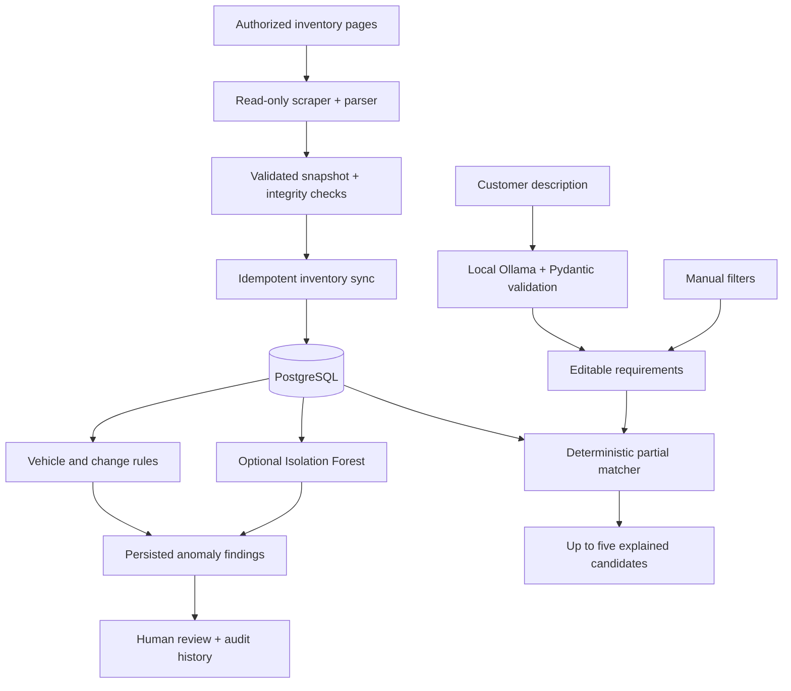
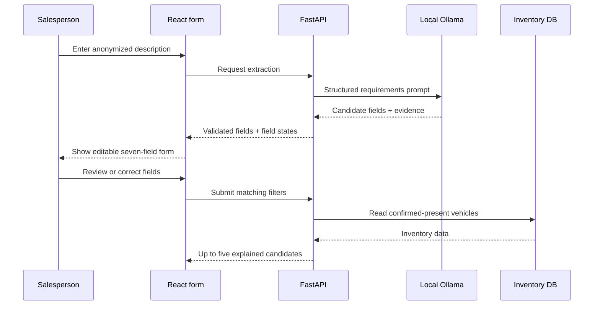

AutoMatch
A full-stack used-car inventory platform combining reliable data synchronization, explainable matching, local LLM requirement extraction, and experimental anomaly detection.

AutoMatch is a full-stack portfolio project built around a practical used-car sales workflow: customers describe what they want, but available vehicles rarely satisfy every condition. Instead of guessing a single "best" vehicle, AutoMatch helps a salesperson inspect up to five inventory-backed candidates, see exactly which requirements each candidate meets or misses, and discuss trade-offs with the customer.

The project emphasizes dependable inventory state transitions, traceable data changes, explicit matching trade-offs, and testable AI/ML integrations. It is designed as an engineering portfolio application, not as a dealership production service.

Live portfolio demo  |  Features  |  Architecture  |  Matching  |  AI extraction  |  ML evaluation  |  Local setup  |  Testing

Project status (November 2026): The feature implementation and local regression checks are complete. The latest audit fixes have not yet been confirmed as pushed, CI-green, and deployed. The hosted site may still be running an earlier revision. This distinction is intentional: a passing local test suite is not a deployment verification.
Demo scope: The public deployment uses 50 synthetic vehicles, not a live dealership feed. Natural-language AI extraction and administrative anomaly review are deliberately unavailable in the public demo. Those capabilities are implemented for controlled local use. This is a portfolio demonstration, not a production dealership system.

Why AutoMatch?
The workflow addresses three related problems:
1. Inventory freshness: vehicle listings change, disappear, and reappear. A useful search system needs reliable synchronization rather than one-off scraping.
2. Explainable compromises: a customer may care about brand, budget, age, mileage, body style, and drivetrain. A salesperson needs to know which constraints a vehicle satisfies, not just receive an unexplained score.
3. Data quality: unusual prices, odometer changes, and inconsistent listings should be surfaced for review without automatically altering inventory.
AutoMatch intentionally does not rank vehicles with an LLM, choose a "best car," store customer profiles, or automate purchase decisions.
Design goals and non-goals
Goal	Deliberate boundary
Keep inventory trustworthy	Incomplete scrapes cannot be interpreted as proof that a car disappeared
Explain trade-offs	Return evidence for each condition, not a single opaque recommendation score
Reduce manual interpretation	Use an LLM to extract requirements, not to generate vehicles or make final decisions
Investigate suspicious data	Produce reviewable anomaly flags, not automated price corrections
Make the system demonstrable	Use separate synthetic public data instead of exposing internal dealership records

The salesperson retains the final decision. A vehicle's presence in the candidate list is not an endorsement, warranty, or confirmation that it is still for sale.
Features
Area	Implementation
Inventory ingestion	Read-only Playwright/BeautifulSoup scraping, HTML parsing, Pydantic validation, structured snapshots
Reliable synchronization	Snapshot completeness and SHA-256 checks, insert/update tracking, idempotent replay, missing-streak handling, safe deactivation and reappearance detection
Vehicle matching	Seven structured filters; deterministic, tolerance-aware partial matching; at most five candidates with per-condition explanations
AI requirement extraction	Local Ollama (qwen3:4b-instruct) converts anonymized customer language into validated fields, field states, and supporting evidence
Anomaly detection	Deterministic vehicle/change rules plus an optional, experimental Isolation Forest detector
Human review	Persisted anomaly findings, deduplication, review decisions, notes, and audit history
User interface	React search form, editable AI-extracted filters, vehicle cards, inventory status, and local anomaly-review workspace
Engineering	PostgreSQL/Alembic, API and UI tests, GitHub Actions CI, isolated test database safeguards, Render/Neon demo

Architecture

The database is the source of truth for vehicles. The LLM extracts customer constraints; it never invents listings, assigns vehicle rankings, or determines eligibility. Matching and inventory synchronization remain deterministic backend responsibilities.
Read and write boundaries
Flow	Reads	Writes	User-facing result
Inventory ingestion	Permitted public listing pages / saved HTML	Raw or validated snapshot	Structured listing data
Inventory synchronization	Validated snapshot + existing rows	Vehicle state and change history	Current inventory and audit trail
Matching	Confirmed-present PostgreSQL vehicles	No inventory mutations	Up to five explained candidates
LLM extraction	Anonymized description	No vehicle mutations	Editable filters plus extraction evidence
Anomaly scanning	Vehicles, historical changes, optional model	Finding/review records	Flags awaiting human judgment
Human review	Flag details and evidence	Review decision, note, audit event	Traceable disposition

Application boundaries
The backend owns validation and matching rules. The React client handles input, feedback and display, but cannot override candidate eligibility. PostgreSQL stores vehicle facts and audit state. Optional LLM and ML components are not required for basic manual matching.

In the deployed portfolio architecture, Render serves the API and built React assets under one origin. Neon provides a separate demonstration database. Public-demo UI restrictions are not a substitute for backend access controls: the administrative routes must remain disabled or restricted in the hosted environment.
Tech stack
- Backend: Python 3.13, FastAPI, Pydantic, SQLAlchemy, PostgreSQL, Alembic
- Scraping/data: Playwright, BeautifulSoup, validated JSON snapshots, SHA-256 integrity checks
- Frontend: React, JavaScript/JSX, Vite, CSS
- LLM: Ollama with local qwen3:4b-instruct; structured extraction and evidence validation
- ML: scikit-learn, NumPy, SciPy, joblib; Isolation Forest with StandardScaler
- Quality/hosting: pytest, FastAPI TestClient/httpx, Vitest, React Testing Library, GitHub Actions, Render, Neon
How it works
1. Validated, idempotent inventory synchronization
The ingestion pipeline parses listing identifiers, titles, cash/finance prices, odometer readings, specifications, and listing URLs into validated snapshots. Before synchronization, it checks snapshot metadata and SHA-256 integrity.

Synchronization distinguishes new, updated, unchanged, missing, and reappeared listings, and records historical field changes. Reprocessing the same snapshot is idempotent.

A missing listing is not immediately treated as sold. Deactivation requires consecutive, successful, complete observations of its absence. Incomplete or failed crawls must not trigger mass deactivation. The inventory model preserves historical records and separately tracks whether a listing is confirmed present (is_active = true and missing_streak = 0).
Ingestion details
- The scraper uses browser automation when necessary, but the parser itself can be tested with saved HTML fixtures; no live dealership access is needed to run parsing tests.
- Listing identifiers are derived from stable source IDs; parser output includes title, year, cash/finance prices, mileage, optional specifications, and original listing/image URLs.
- Number normalization accepts standard thousands separators (including ordinary and nonbreaking spaces) and common mileage suffixes. Unsupported, malformed, decimal, or negative representations return an unknown value rather than silently becoming a misleading positive integer.
- Snapshot integrity is tracked with SHA-256, and synchronization checks completeness before applying absence logic.
Synchronization state and invariants
Observation	Intended behavior
New source listing ID	Insert one vehicle record and retain provenance
Same listing and same fields	No duplicated vehicle or misleading change record
Existing listing with changed fields	Update the row; create traceable historical changes
Listing absent from a complete successful snapshot	Increase the absence streak; deactivate only after repeated confirmed absence
Listing absent from a failed/partial snapshot	Do not infer removal from an incomplete observation
Previously missing listing reappears	Restore confirmed-present state and retain the historical transition
Snapshot reprocessed	Idempotent replay; do not produce duplicate business events

The Vehicle record stores a listing title; manufacturer and model matching may derive from vehicle text rather than independent stored make/model columns. A missing price_cash is kept unknown and never substituted with price_finance.
Audit model
The central persisted entities include Vehicle, InventorySnapshot and InventoryChange. A snapshot identifies the observed data/run; changes preserve old/new field values and change types. Anomaly findings are stored separately so that detection and review never silently rewrite the original facts.

This design prioritizes data consistency and recoverability rather than assuming that every external crawl succeeds.
2. Explainable five-candidate matching
The matching API supports seven optional customer constraints:
Field	Meaning
max_budget	Maximum cash price in CAD
make	Preferred manufacturer
model	Preferred model
min_year	Minimum model year
max_mileage_km	Maximum odometer reading
body_style	Vehicle body style
drivetrain	Drivetrain requirement

The matcher searches confirmed-present inventory only, evaluates the supplied constraints, and returns up to five candidates with met, not_met, or unknown results and plain-language explanations.

The implemented eligibility rule requires at least 50% of specified conditions to be met, with bounded tolerances for near matches: 10% for budget, 15,000 km for mileage, and two model years. These rules govern partial-match eligibility; they are not weights in a ranking model. When a make or model is supplied, at least one of those identity constraints must match. Hard tolerance violations exclude a vehicle even if other conditions are met. Backend ordering is preserved rather than presenting an AI-selected winner. Missing cash prices are not replaced with finance prices.
Why partial matching rather than ranking?
A customer may request a recent Toyota SUV with AWD under a certain cash budget. A vehicle can satisfy most conditions while narrowly missing the price or year requirement. AutoMatch surfaces the exact compromises so that a salesperson can discuss them. It does not learn a preference score or assert which compromise is best.

For each supplied field, the backend reports a condition result:
- met  -  the requirement is satisfied by known inventory data.
- not_met  -  the known value fails the requirement; numeric explanations may show the difference.
- unknown  -  the relevant inventory value is missing or insufficient to decide.
The 50% rule is a candidate inclusion threshold, subject to identity overlap and hard numeric tolerances; it does not imply that a result meets every requirement. The bounded numeric tolerances make near matches eligible for discussion but do not redefine factual values. Results are truncated to at most five, preserving backend-defined order instead of inventing a best-to-worst ranking.
Input and response guarantees
- At least one customer condition must be supplied; whitespace-only string inputs are rejected or normalized before matching.
- Budget is a positive cash-price limit; years are bounded and mileage is nonnegative. Frontend and backend apply field-specific input checks.
- The browser uses a response adapter to display the backend's candidate/condition data. It does not re-rank candidates.
- An empty result is a valid outcome, not a reason to fabricate a vehicle.
Example matching request:
POST /api/vehicles/match
Content-Type: application/json
{
  "max_budget": 30000,
  "make": "Toyota",
  "model": null,
  "min_year": 2020,
  "max_mileage_km": 100000,
  "body_style": "SUV",
  "drivetrain": "AWD"
}
Other application endpoints include GET /api/inventory/status for inventory freshness and POST /api/requirements/extract for natural-language extraction. Administrative anomaly-review endpoints are separate from the public search experience.
API overview
HTTP	Route	Purpose	Public-demo behavior
POST	/api/vehicles/match	Retrieve and explain at most five inventory-backed candidates	Available
GET	/api/inventory/status	Show inventory freshness and synchronization information	Available
POST	/api/requirements/extract	Convert a description into proposed fields	Not publicly exposed
Administrative routes	Under the backend anomaly/review modules	Review findings, decisions and notes	Disabled / not publicly exposed

The exact request and response models live in their FastAPI/Pydantic modules. This table is a functional overview, not a complete OpenAPI contract; use the application's generated API documentation when running the backend locally.
3. Human-reviewed AI extraction
In the local workspace, a salesperson can enter an anonymized request such as:
"I need a Toyota SUV under $30,000, 2020 or newer, with AWD."

The Ollama-backed service extracts structured fields validated by Pydantic, along with field states (explicit, missing, ambiguous, or preference) and supporting evidence. Only clearly explicit requirements populate active matching filters; uncertain or preferential language is not silently converted into hard constraints.

The user can review and edit all seven fields before searching. Extraction does not automatically call the matcher. If the natural-language description changes after extraction, the UI warns that the current filters may be stale and requires re-extraction or explicit confirmation before searching. Manual entry remains available if the local model is unavailable.

Recorded extraction evaluation: 50 synthetic labeled statements, 350 field-level decisions, 93.43% field-decision accuracy, 100% explicit-requirement recall, and 3.85% hallucinated-constraint rate in the milestone evaluation. These are results on a controlled synthetic set, not claims of performance on real customer conversations; they predate the latest evidence-consistency audit fix.

See evaluation/README.md and evaluation/run_extraction_eval.py for the evaluation workflow.
Extracted requirement lifecycle

Evidence consistency is checked before treating selected text-based fields as explicit. If a claimed make, model, body style or drivetrain contradicts its evidence, the application does not blindly activate that filter. This is a bounded lexical consistency check, not a guarantee that an LLM interpretation is correct.

When a user edits the natural-language description after a successful extraction, the UI marks the existing fields as potentially stale. It preserves manual changes and requires the user either to extract again or to explicitly confirm continued use of the existing form. Extraction errors leave the manual form available.
Evaluation cautions
The published evaluation uses a fixed synthetic labeled dataset and measures extraction decisions rather than the quality of vehicle recommendations. These results should not be interpreted as customer-facing accuracy in production. The post-evaluation evidence-consistency rule is covered by targeted tests, but the historical extraction figures were not claimed to have been recomputed after that change.
Anomaly detection and evaluation
AutoMatch separates deterministic data-quality checks from experimental ML detection.
- Current-record rules: invalid years, nonpositive prices, negative mileage, invalid identity fields, and inconsistent missing-streak values.
- Historical-change rules: unusually large cash-price changes and odometer decreases, including changes on reappearing listings.
- Isolation Forest: an optional unsupervised detector using vehicle_age, log_cash_price, and log_mileage_km. Model availability and metadata are validated before inference; the rules remain useful when the model is unavailable.
Findings are persisted with stable identities to avoid duplicating the same issue on repeated scans. Reviewers can inspect evidence, record decisions and notes, and retain an audit trail. Flags do not automatically modify listing prices, deactivate vehicles, or prove that a listing is wrong. An Isolation Forest score is not a probability of error.
Experimental results
The documented iforest_v1 experiment trained on 161 real inventory vehicles and evaluated 40 held-out original records plus 40 synthetic perturbations (80 cases). Synthetic scenarios multiplied or divided cash price and mileage by large factors.
Metric on this synthetic evaluation	Isolation Forest	Paired historical-change rules
Synthetic anomaly recall	22.5%	75%
Flag rate on held-out original vehicles	7.5%	0%
Precision on the balanced constructed set	75%	100%

Interpretation matters: historical-change rules were given old and new values, while Isolation Forest saw only current numeric features. This is not an equal-information benchmark. The 40 original records were assumed, not verified, normal; these figures are not production detection metrics. Isolation Forest did not outperform the paired-change rules in this experiment and is retained as an evaluated, human-reviewed experimental component, not a replacement for deterministic checks.

See ml/EXPERIMENT_REPORT.md and ml/README.md for experimental setup, reproducibility, and limitations. Trained joblib artifacts are generated locally and are not required by the public demo.
Model and data protocol
The documented iforest_v1 study used an initial pool of 219 confirmed-present listings; 201 had enough data for price-based features. The 201 eligible rows were split into 161 training and 40 held-out original listings. Only the holdout was used to construct 40 synthetic anomalies, preventing the same listing identity from appearing in both training and evaluation.
Item	Recorded configuration
Feature version	v1
Input features	vehicle_age, log_cash_price, log_mileage_km
Preprocessing	StandardScaler inside an sklearn pipeline
Model	IsolationForest
Number of trees	n_estimators=200
Contamination setting	0.05
Random seed	42
Evaluation set	40 held-out originals + 40 injected anomalies

Synthetic anomalies were created in equal groups by multiplying cash price by four, dividing it by five, multiplying mileage by four, or dividing it by five. This intentionally tests large shifts; it does not approximate the complete distribution of dealership data errors.
Evaluation result	Snapshot checks	Isolation Forest	Historical-change rules
True positives	0	9	30
False negatives	40	31	10
False positives on assumed-normal originals	0	3	0
True negatives	40	37	40
Synthetic recall	0%	22.5%	75%

In 38 of 40 synthetic pairs, the transformed vehicle received a more anomalous model score. That is a score-direction observation, not a 95% true-positive rate. It is also invalid to interpret model scores as calibrated probabilities.

The paired-change baseline has richer input (old and new values). As such, comparing it with a current-state-only model is useful operationally but is not a controlled like-for-like model comparison.
Human-in-the-loop anomaly workflow
1. An operator runs a controlled scan against an authorized local environment.
2. Current-state validation and historical-change rules run; an optional compatible local model may add findings.
3. The application persists findings with stable fingerprints so that repeat scans can recognize known issues.
4. A reviewer inspects evidence and may label a finding as a valid issue or a false alarm, with an optional note.
5. Review decisions and audit events remain traceable. Detection does not rewrite source vehicle attributes or automatically remove listings.
Model artifacts under ml/artifacts/ are generated locally. The scan must handle absent or incompatible model metadata without treating model inferences as confirmed truth. For experiment details, use ml/EXPERIMENT_REPORT.md, ml/README.md and the ML source modules rather than the top-level README as the scientific record.
Reproducible evaluation and experiment artifacts
AutoMatch contains two distinct AI-related evaluations, which answer different questions:
Study	Evaluation target	Interpretation
Requirement extraction (evaluation/)	Whether natural language was converted into supported, justified structured fields	Field-level quality on synthetic labeled customer requests
Anomaly detection (ml/)	Whether rules and an optional model flag controlled numerical perturbations	Detector behavior on a constructed holdout, not verified real-world fault rates

Requirement extraction evaluation
evaluation/requirement_cases.py supplies synthetic, manually labeled cases. evaluation/run_extraction_eval.py runs the extraction evaluation and records aggregate field decisions. This workflow depends on the configured local LLM, so results can vary with the model version and inference settings. Do not publish real customer messages as benchmark inputs.
Anomaly-model reproducibility
The source includes feature preparation, training, and evaluation modules under ml/, plus ml/EXPERIMENT_REPORT.md for methodology and recorded metrics. The iforest_v1 joblib model and metadata are generated artifacts, not a guaranteed checked-in dependency. A fresh local installation should train or provide compatible artifacts before enabling model-based scanning; deterministic rule checks do not require the model.

A model or evaluation artifact should record its feature schema, training configuration, random seed, and compatible library versions. Reproducing a synthetic experiment does not validate performance against genuine, independently confirmed inventory errors.
Public demo and deployment
Open the public AutoMatch demo

The portfolio deployment uses Render for the application and a separate Neon PostgreSQL demo database. It is intentionally segregated from local development, local testing, and any real inventory.
- The demo is populated with 50 explicitly synthetic vehicle listings, identified with DEMO- source IDs and (Synthetic Demo) titles. Placeholder .invalid URLs are not real sale listings.
- Visitors can explore manual filtering, partial-match explanations, vehicle cards, and inventory information without relying on a dealership site.
- Local Ollama extraction is not exposed in the public demo; no publicly hosted model is implied.
- Administrative anomaly review is not exposed in the public demo. Review operations belong to a controlled local/admin workflow.
- The hosted sample is a demonstration of the application's behavior, not evidence of live dealership integration or real-time vehicle availability.
Demo dataset provenance
The reproducible synthetic inventory fixture is located at data/demo/synthetic_inventory_v1.json; generator and seeder utilities live under backend/demo/. Demo records use conspicuous synthetic identifiers (DEMO-...) and titles marked (Synthetic Demo). Links ending in .invalid are placeholders, not source dealership URLs. The public dataset contains 50 records, and the demo does not require an external crawler.

To inspect the seeder's supported arguments without applying a database write:
python -m backend.demo.seed_database --help
The generator is implemented in backend/demo/generate_inventory.py; its default execution is documented as a dry run. Review that script's current options before generating or replacing local demo fixtures.

Do not assume that seeing a seed command makes it safe to run: the seeder has explicit target checks and a separate opt-in apply path. Never run a demo seeder against real inventory or an unverified hosted database.
What deployment does and does not establish
The hosted application demonstrates the user interface and matching API backed by a dedicated Neon demo database. It does not establish that a background scraper is continually refreshing source listings, that customers' private text is processed by a hosted model, or that administrator review endpoints are generally accessible. Render/Neon configuration and the running revision should be checked separately after each code push.

On a free hosting tier, an idle application may take additional time to start. Deployment and local development use separate database targets and configuration.
Repository guide
AutoMatch/
+-- backend/
|   +-- ai/                  # LLM extraction, validation, usage maintenance
|   +-- anomalies/           # Scan orchestration and review integration
|   +-- api/                 # FastAPI routes
|   +-- database/            # SQLAlchemy models, connection and target guard
|   +-- inventory/           # Snapshot synchronization and CLI
|   +-- matching/            # Rule-based matcher and schemas
|   +-- scraper/             # Browser scraper, parser, normalizer, validation
|   +-- main.py              # FastAPI application
+-- frontend/src/            # React UI, API adapters, component tests
+-- ml/                      # Rules, feature engineering, training, evaluation
+-- evaluation/              # Labeled LLM extraction evaluation cases
+-- tests/                   # Backend unit and integration tests
+-- .github/workflows/ci.yml # PostgreSQL-backed CI and frontend checks
+-- conftest.py              # Isolated pytest database guard
+-- README.md
The repository also contains Alembic migration configuration and migration files. Generated snapshots, model artifacts, credentials, and local build outputs should not be committed as source files.
Key code entry points
Location	Responsibility
backend/scraper/normalizer.py	Strict interpretation of prices, mileage and similar numeric fields
backend/scraper/parser.py	Vehicle-card parsing and inventory-page de-duplication
backend/inventory/run_sync.py	Local snapshot synchronization command with write-target protection
backend/database/target_guard.py	Confirm local PostgreSQL and exact database identity for guarded administrative writes
backend/matching/schemas.py	Input schema and field validation
backend/ai/extractor.py	Local model extraction and evidence checks
backend/anomalies/scan_service.py	Detector orchestration and anomaly persistence
ml/rule_baseline.py, ml/change_rules.py	Deterministic current-record and historical-change checks
frontend/src/api/match.js	Frontend payload validation and API response adaptation
frontend/src/App.jsx	Search form, extraction workflow and candidate display
conftest.py	Test database identity guard, executed at pytest session startup

Files are organized by responsibility to keep scraper, inventory writes, matching, extraction and anomaly review independently testable.
Getting started
The instructions below target Windows PowerShell, the primary development environment. Other platforms can use equivalent commands.
Prerequisites
- Python 3.13 and a compatible package installer
- Node.js and npm (CI uses Node 24)
- Local PostgreSQL (CI uses PostgreSQL 17)
- Optional: Ollama and the local qwen3:4b-instruct model for AI extraction
- Permission to access any external inventory source before running the scraper
Backend setup
From the repository root:
py -3.13 -m venv .venv
.\.venv\Scripts\Activate.ps1
python -m pip install -r requirements.txt
Configure the application's DATABASE_URL for a local PostgreSQL database you control. Keep the connection string and all API keys in local environment configuration; never commit .env files or credentials. Apply the repository's Alembic migrations only after confirming the intended database host and name:
python -m alembic upgrade head
Start the API:
python -m uvicorn backend.main:app --reload
Database configuration checklist
Before applying migrations, starting synchronization or running administrative commands:
1. Check that DATABASE_URL targets the intended database and host.
2. Confirm that the PostgreSQL database actually exists and belongs to the correct environment.
3. Do not reuse the hosted Neon demonstration connection for local development or tests.
4. Keep all passwords, API keys and reviewer credentials outside Git.
5. Treat Alembic upgrades as schema-changing operations; apply them only to a database you intentionally manage.
Database environment variables can be supplied through local configuration. A shell-level override may take precedence over a .env file; verify this when switching between development and isolated tests.

The backend normally runs on http://127.0.0.1:8000. Start optional local Ollama separately using the model/configuration expected by backend/ai/extractor.py. The rest of the manual matching interface does not require the LLM.
Safety: Database migrations and synchronization commands can write data. Confirm the database target first. Do not run a write operation against a hosted Neon database or live inventory when following local-development examples.

Frontend setup
In a second terminal:
cd frontend
npm ci
npm run dev
Open the Vite development URL printed in the terminal. The frontend uses the matching and inventory API; make sure the backend is running. Public-demo behavior is controlled by VITE_AUTOMATCH_PUBLIC_DEMO=1 in the appropriate build environment.
Controlled inventory and anomaly operations
Inventory synchronization and maintenance are not required to explore the synthetic demo. For local workflows, use the existing scripts in backend/inventory/ and backend/anomalies/ only after checking the target database, input snapshot, and CLI help.

The write-capable synchronization, anomaly-scan, and AI-usage-cleanup CLIs require an explicit --apply action and an exact --confirm-database value for supported guarded operations. The guard rejects non-local targets and verifies the actual connected database name. Do not bypass these checks or substitute a production connection string in examples.
Administrative write guard
backend/database/target_guard.py checks three separate things before a guarded local write:
- Driver/backend: the SQLAlchemy engine is PostgreSQL.
- Connection target: the configured host is loopback (localhost, 127.0.0.1 or ::1) and the configured database matches --confirm-database exactly.
- Actual connection: SELECT current_database() confirms the connected database name, not merely the URL string.
A mismatch raises a dedicated refusal error rather than applying the operation. This guard is designed for selected local administrative CLI workflows; it should not be described as a universal access-control system for every possible application write.

Read CLI help and review the intended snapshot or scan before choosing any write-capable flags:
python -m backend.inventory.run_sync --help
python -m backend.anomalies.scan_cli --help
python -m backend.ai.cleanup_usage --help
The above commands are help-only; they are provided instead of unsafe sample --apply commands.
Testing
Last locally verified full regression (2026-11-09):
Suite	Result
Backend pytest	349 passed
Frontend Vitest	39 passed across 7 test files
Frontend production build	Passed
Combined backend + frontend tests	388 passed

Backend  -  isolated PostgreSQL only
The backend suite includes database tests. It must run against the dedicated, local automatch_test PostgreSQL database, not the usual automatch development database and never Neon. The root conftest.py requires AUTOMATCH_RUN_DB_TESTS=1 and validates the target database and local PostgreSQL host before the suite runs. You must create the dedicated test database separately and apply the current Alembic migrations to that database before running the suite. The test guard does not create the database or migrate its schema.

After independently verifying a local automatch_test connection, set the test environment and run:
# Replace the placeholder with your own local PostgreSQL credentials.
$env:DATABASE_URL = "postgresql+psycopg://<user>:<password>@127.0.0.1:5432/automatch_test"
$env:AUTOMATCH_RUN_DB_TESTS = "1"
python -m pytest -q
Do not enable the test guard while pointing DATABASE_URL at the normal development database. Remove shell-level test environment overrides when returning to development; database-backed tests may write and roll back data inside the isolated test database.
How the test guard works
The root conftest.py performs its check at pytest session startup:
1. Require the explicit opt-in variable AUTOMATCH_RUN_DB_TESTS=1.
2. Refuse non-PostgreSQL targets, non-loopback hosts and databases not named automatch_test.
3. Open a connection and confirm SELECT current_database() returns automatch_test.
The guard is independent of the number of DB tests in the selected subset: even a pure parser test launched from the repository root must satisfy the safe test configuration. Tests can modify or roll back data inside the isolated test DB. The guard does not create the database or automatically migrate its schema.

If the PowerShell session was previously used for development, clear the overrides after the test run:
Remove-Item Env:AUTOMATCH_RUN_DB_TESTS -ErrorAction SilentlyContinue
Remove-Item Env:DATABASE_URL -ErrorAction SilentlyContinue
Only remove the shell overrides if your ordinary development connection is configured elsewhere. Re-establish the intended connection before any later write operation.
What is tested
The backend coverage includes data parsing, snapshot validation and synchronization, matching rules and API contracts, AI validation/evidence consistency, anomaly scan persistence, CLI target protection, and database-backed integration scenarios. The frontend uses Vitest and React Testing Library to cover search and candidate rendering, natural-language extraction interactions, stale-filter confirmation, inventory status, review UI and public-demo restrictions.

Test totals are a snapshot of the last local run, not an automatically updated badge. Separate suites may overlap in targeted regression counts; only the full-suite totals above should be reported as the final count.
Frontend
cd frontend
npm ci
npm test
npm run build
Continuous integration
.github/workflows/ci.yml runs database migrations and backend tests against a disposable local PostgreSQL service database named automatch_test, then executes frontend Vitest tests and a production Vite build. It uses Python 3.13, PostgreSQL 17 and Node 24. Local regression results do not, by themselves, confirm the latest GitHub Actions run or a new hosted deployment; check both after pushing a release.
CI database safety
The workflow uses a PostgreSQL 17 service with POSTGRES_DB=automatch_test and a loopback DATABASE_URL naming the same database. It sets AUTOMATCH_RUN_DB_TESTS=1, applies migrations and then runs pytest. The database is disposable CI infrastructure; it does not point at Render/Neon or the developer's usual automatch database.

The expected release sequence is local regression -> review diff -> commit -> push -> GitHub Actions verification -> hosted deployment verification. Successful local tests do not establish any later step automatically.
Safety, privacy and operational boundaries
- Read-only source access: scraping should only target pages for which automated access is authorized and must respect applicable site rules. AutoMatch does not write to the dealership's website.
- No customer PII: do not enter names, phone numbers, contact details, or addresses into natural-language prompts. Prefer synthetic or anonymized customer descriptions.
- Inventory correctness: failed or incomplete snapshots do not justify deactivating listings; inactive means no longer observed, not necessarily sold.
- Review before action: anomaly rules and ML produce review flags; they do not automatically repair data or make pricing decisions.
- Environment isolation: production/demo, development, and test databases are separate; sensitive configuration and real snapshots are excluded from public demo data.
- Transparent matching: unknown attributes remain unknown, and a partial match is not a recommendation or guarantee of availability.
Troubleshooting
Symptom	First check
pytest refuses to start	Verify AUTOMATCH_RUN_DB_TESTS=1, local PostgreSQL and exact DB name automatch_test
Database test reports migration/table problems	Confirm the test database has the current Alembic schema; do not redirect tests to development
Matching request returns a 422 response	Check at least one nonblank filter and the budget/year/mileage constraints
AI extraction is unavailable	Confirm a local Ollama instance/model is configured; use manual filters without AI
Matching returns no candidates	Check inventory status, active/missing state and whether the requested constraints are too restrictive
ML flags are absent	The optional local model artifact may be missing or incompatible; deterministic checks are separate
Frontend form does not submit	Inspect browser-native numeric min/`step` validation and backend validation messages
Public demo has no extraction or review controls	Expected intentional public-demo restriction
Render app starts slowly	Free-tier service may need to wake from an idle state

For an unexpected behavior, use the smallest relevant test first, then run the full regression after making changes. Never disable database safety checks just to force a test to start.
Limitations and future work
- The scraper depends on the source site's HTML structure and access permissions; live snapshots are not part of the public demo.
- Local LLM extraction can be inaccurate or ambiguous and requires human verification. The published evaluation uses synthetic labels.
- Isolation Forest was trained on a small, heterogeneous sample; its synthetic anomaly-detection performance is limited, and outputs need human review.
- The public deployment is intentionally feature-limited and is not a secured multi-user CRM or an operational dealership platform.
- Possible future improvements include stronger evidence semantics, broader independent evaluation datasets, improved anomaly calibration, and more robust production monitoring. These are future work, not implemented capabilities.
Engineering decisions and trade-offs
Decision	Benefit	Trade-off
Keep vehicle matching deterministic	Explains why each listing appears and preserves business control	Does not learn personal preferences or rank the best vehicle
Use complete snapshots before absence transitions	Prevents partial crawls from falsely deactivating inventory	Requires completeness validation and historical state
Separate rules from optional Isolation Forest	Rules remain available without local model artifacts	ML offers limited additional evidence in this small-data setting
Require human confirmation after LLM extraction	Reduces accidental activation of uncertain constraints	Adds a review step before searching
Require explicit database identity for local CLI writes and pytest	Lowers the risk of accidental writes to non-test targets	Test setup needs a dedicated PostgreSQL database
Deploy only synthetic data publicly	Provides a shareable demonstration without exposing live inventory	The hosted app does not demonstrate real-time source ingestion

Known boundaries
This repository is a portfolio implementation: it does not provide production-grade multi-tenant authentication, a guaranteed scraper SLA, a live vehicle-sales feed, a hosted LLM, or a calibrated ML error probability. A successful local test suite verifies the tested code in that environment, not the current deployed Git revision. These boundaries are intentional and should remain visible when describing the project.
The last four items are not marked complete based solely on local code and console output.
Project principle: Use automation to make inventory data more reliable and customer trade-offs more understandable - while keeping consequential decisions with the salesperson or reviewer.